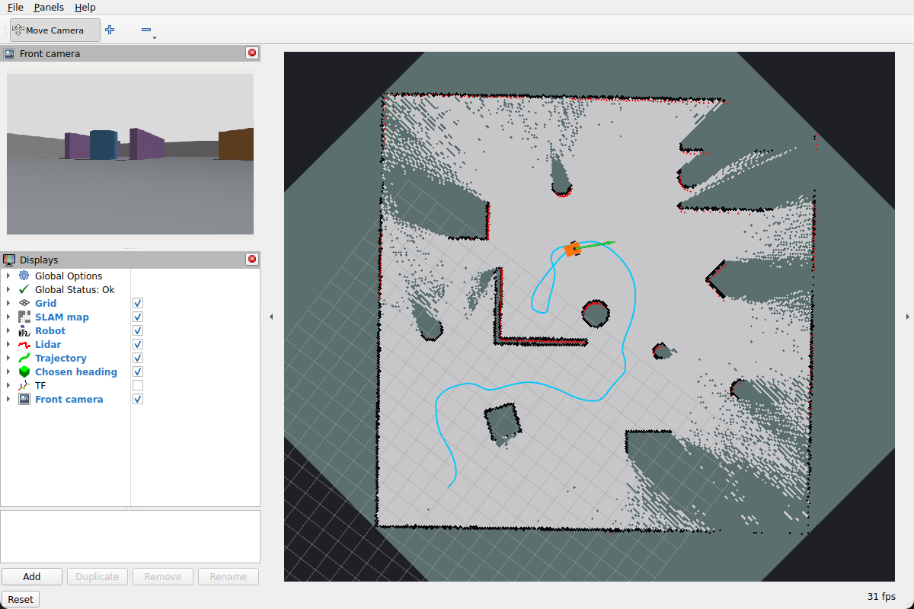
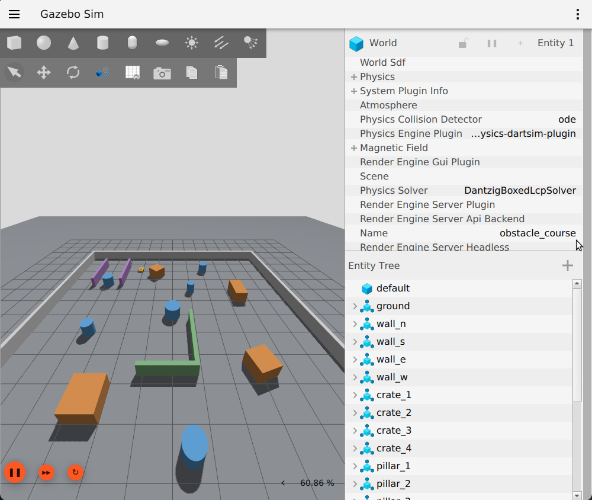
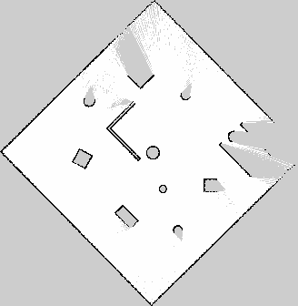

# Robotics Workstation Setup (Linux · Windows · macOS)

One command installs a full robotics toolchain, from circuit board to walking humanoid: ROS 2 with Gazebo,
navigation, mapping and manipulation; electronics and mechanical CAD; 3-D printing; simulators; embedded
tools; and Python environments for physics, humanoid locomotion and robot learning. Each run ends with a
**verification report** that tests the tools for real: ROS 2 nodes exchange messages, MuJoCo simulates,
Pinocchio builds a humanoid model, and LeRobot loads its policies.



| | Linux (Ubuntu 22.04 / 24.04) | Windows 10 / 11 | macOS 14+ |
|---|---|---|---|
| Installer | `linux/install.sh` | `windows/install.ps1` | `macos/install.sh` |
| ROS 2 | Humble (22.04) or Jazzy (24.04), official apt | Jazzy via [RoboStack](https://robostack.github.io) (conda) | Jazzy via RoboStack (conda) |
| Gazebo | Harmonic, official apt | via RoboStack `ros-jazzy-ros-gz` | via RoboStack `ros-jazzy-ros-gz` |
| Apps | vendor repos / tarballs | winget | Homebrew |
| Tested | ✅ on real hardware ([report](outputs/)) | ⚠️ parser-checked + dry-run with mocked commands, not yet run | ⚠️ dry-run with mocked commands, not yet run |

## Install

```bash
git clone https://github.com/shreyas974/robotics-workstation-setup.git
cd robotics-workstation-setup
```

**Linux**
```bash
./linux/install.sh
```
**macOS** (needs [Homebrew](https://brew.sh))
```bash
./macos/install.sh
```
**Windows** (normal PowerShell)
```powershell
powershell -ExecutionPolicy Bypass -File windows\install.ps1
```

Options:

| Linux / macOS | Windows | Skips |
|---|---|---|
| `--no-ros` | `-NoRos` | ROS 2 and Gazebo |
| `--no-design` | `-NoDesign` | KiCad, FreeCAD, Blender, OrcaSlicer |
| `--no-sim` | `-NoSim` | Webots |
| `--no-embedded` | `-NoEmbedded` | Arduino IDE, PlatformIO |
| `--no-envs` | `-NoEnvs` | Python environments |
| `--humanoids` (Linux) | | adds ~4.5 GB of open-source humanoid designs |
| `--dry-run` | `-DryRun` | everything: shows what would happen |

The scripts are safe to run again: anything already installed is skipped. Logs go to `logs/`, and the
report to `outputs/<computer>-<os>.md`.

## What you get

| Stage of building a robot | Tools |
|---|---|
| Electronics | **KiCad 10** (schematic + PCB), **ngspice** (SPICE simulation, Linux) |
| Mechanical CAD | **FreeCAD**; on Linux with the **RobotCAD** workbench (CAD to URDF / ROS 2 package) |
| 3-D printing | **OrcaSlicer** |
| Rendering | **Blender** |
| Firmware | **Arduino IDE**, **PlatformIO** (ESP32, STM32, AVR, RP2040) |
| Robot software | **ROS 2**: desktop (RViz2, rqt), Nav2, SLAM Toolbox, MoveIt 2, ros2_control (Linux), robot_localization (Linux), xacro, teleop |
| Simulation | **Gazebo Harmonic** + ROS bridge, **Webots**, **MuJoCo**, **PyBullet** |
| Physics + RL (env `sim`) | MuJoCo, PyBullet, Gymnasium, Stable-Baselines3, Open3D |
| Humanoids (env `humanoid`) | **MuJoCo Playground** (JAX; GPU on Linux + NVIDIA), **Pinocchio**, **Crocoddyl** (not on Windows), onshape-to-robot |
| Robot learning (env `lerobot`) | **Hugging Face LeRobot** (ACT, Diffusion Policy, SmolVLA), faster-whisper for speech |

Free online tools that pair well: [Wokwi](https://wokwi.com) (microcontroller simulation),
[Falstad](https://www.falstad.com/circuit/) (circuit simulation), [Onshape](https://cad.onshape.com) (cloud CAD,
free for students), [The Construct](https://app.theconstruct.ai) (ROS in the browser).

### Using it

```bash
ros2env                                   # Linux: loads ROS 2 (+ ~/ros2_ws) in this terminal
conda activate ros                        # Windows / macOS: ROS 2 Jazzy + Gazebo (RoboStack)
gz sim shapes.sdf                         # Gazebo
conda activate humanoid && train-jax-ppo --env_name G1JoystickFlatTerrain --num_envs 512
conda activate lerobot && lerobot-train --help
```

### Notes per OS

- **Linux** is the reference platform: ROS 2 and Gazebo are tier-1 there, and everything above was installed and
  verified on Ubuntu 22.04 with an RTX 3050 laptop GPU.
- **Windows:** RoboStack needs the Visual Studio 2022 Build Tools (installed for you) to build your own ROS
  packages. For the full apt-based experience, use WSL 2 from an admin PowerShell:
  `wsl --install -d Ubuntu-24.04`, then run `linux/install.sh` inside Ubuntu. Crocoddyl has no Windows build.
- **macOS:** RoboStack's current builds need macOS 14 or newer. MuJoCo wheels are Apple Silicon only, and JAX
  runs on the CPU there, which is fine for testing; train large policies on a CUDA machine.
- **NVIDIA Isaac Sim / Isaac Lab** are not included: NVIDIA's minimum is a 16 GB RTX GPU.

## Check any machine

```bash
python3 verify/verify.py                 # or: python verify\verify.py on Windows
```

## Output from a real machine

[`outputs/`](outputs/) holds the verification report from the machine this was built on (Ubuntu 22.04,
RTX 3050 Laptop 4 GB), plus results from an obstacle-avoiding robot built with this stack
([obstacle_bot](https://github.com/shreyas974/obstacle_bot)): 3 of 3 headless 3-minute trials collision-free,
and a 4-minute run in Gazebo with SLAM mapping, 101 m and 0 collisions.

| Gazebo | Map the robot built (SLAM Toolbox) |
|---|---|
|  |  |

## Principles

- **Official sources only:** ROS, OSRF, KiCad, Cyberbotics, Blender and Arduino downloads; winget; Homebrew;
  conda-forge and RoboStack; PyPI.
- **Verified downloads:** SHA-256 for Miniforge, Blender and OrcaSlicer; Authenticode signature shown for Webots on Windows.
- **No `curl | sh`**, and nothing in system Python: libraries live in conda environments.
- **ROS is sourced on demand** (`ros2env`), so it never clashes with your Python environments.
- **Re-runnable and logged**, with failures listed at the end, never hidden.

## Related

- [aiml-workstation-setup](https://github.com/shreyas974/aiml-workstation-setup): PyTorch, LLM, vision and
  data-science environments for Linux, Windows and macOS.
- [obstacle_bot](https://github.com/shreyas974/obstacle_bot): an autonomous robot in Gazebo + ROS 2.
- [ARIA](https://github.com/shreyas974/aria): language-commanded robot arm (LLM, trained vision, IK) in MuJoCo.

## License

MIT
